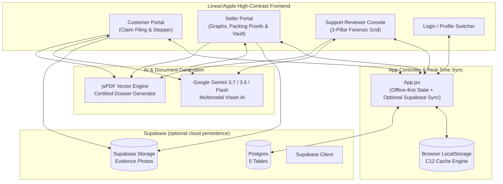

# Damaged Product Evidence Assistant
## Comprehensive Technical, Architectural & User Guide

---

## 1. Executive Summary

**Damaged Product Evidence Assistant** (C12 Evidence Engine) is an enterprise-grade, multimodal AI-powered platform designed to resolve the multi-billion-dollar dilemma of damaged e-commerce goods, return disputes, and fraudulent claims. 

In traditional e-commerce returns, marketplaces face a critical challenge:
* **Customers** receive broken goods and demand immediate replacements or refunds.
* **Sellers** claim products were dispatched in pristine condition from their fulfillment centers.
* **Logistics Couriers** dispute whether damage happened in transit or was pre-existing.
* **Fraudulent actors** exploit return policies through item substitution, deliberate tampering, or staged damages.

**Damaged Product Evidence Assistant** resolves this through **Tri-Party Photographic Cross-Verification**:
1. **Seller Pre-Dispatch Baseline**: Before-packing (unit serials, factory seals) and After-packing (sealed box, security tape, scale weight).
2. **Customer Delivery Evidence**: Received package photos, damage vectors, and quoted defect statement.
3. **Google Gemini Multimodal Vision AI**: Cross-analyzes visual features across all images, computes fraud probability %, assigns a Risk Level (`SAFE`, `LOW`, `MODERATE`, `HIGH`), and outputs actionable settlement recommendations (`REPLACE`, `REFUND`, `RETURN`, or `CONTEST`).

---

## 2. High-Level System Architecture



---

## 3. Portals & User Workflows

### 3.1 Customer Portal (`currentTab === 'customer'`)
* **Hero Greeting & AI Status**: Context-aware welcome displaying verified customer status.
* **4 Metric Cards with Sparklines**:
  * **Total Orders**: Orders placed by the customer.
  * **Total Returns**: Historical return volume.
  * **Total Refunds**: Completed monetary reversals.
  * **Active Claims**: Open dispute dockets.
* **5-Step Interactive Stepper**:
  * Step 1: Select Delivered Order
  * Step 2: Quoted Problem Category
  * Step 3: Quoted Damage Details
  * Step 4: Upload Photo Evidence (up to 5 angles)
  * Step 5: Gemini AI Analysis & Claim Submission
* **Gemini AI Instant Assessment Console**:
  * Live cross-comparison against seller's stored packing baseline.
  * Verdict display: Authenticity (`ORIGINAL` vs `FRAUD`), Risk Level, Root Cause, Primary Liability.
  * Automated generation and download of certified **Evidence Dossier PDF**.

### 3.2 Seller Portal (`currentTab === 'seller'`)
* **Immediate Zero-Friction Entry**:
  * Defaults immediately to active seller store (`Apex Tech & Retail Solutions SLR-1001` or `Nexora Global SLR-1002`).
  * Instant switching via top dropdown or "+ Register Store" modal without blocking auth barriers.
* **4 Subtabs**:
  1. **Sales & Returns Graphs (`analytics`)**:
     * Visual metrics for Total Dispatches, Total Claims, Packing Proofs, and Fraud Flagged claims.
     * Dynamic visual bar graphs displaying Dispatched Volume vs Returns Rate vs In-Transit Damage vs AI-Flagged Fraud.
  2. **Redirected Claims & AI Decisions (`cases`)**:
     * Customer claims linked to this merchant's products.
     * Filterable by All, Suspected Fraud, Genuine, or Pending.
     * Side-by-side photo comparison: Customer photo alongside Seller Pre-dispatch photo.
     * AI Decision display: `REPLACE`, `REFUND`, `RETURN`, `CONTEST`.
     * 1-Click Action buttons: "Approve Replacement", "Issue Instant Refund", "Contest as Fraud".
  3. **Enter Product Packing Proofs (`new-record`)**:
     * Double-click protected form to record outgoing shipments.
     * **Section A**: Order Number, Product Name, SKU, Category, Sale Price, Customer Details.
     * **Section B (Before Packing)**: Unboxed product photo, serial/IMEI, QC Inspector ID, QC verification checklist (seal intact, power test passed, zero cosmetic blemishes).
     * **Section C (After Packing)**: Sealed box photo, packaging type (3-ply corrugated), tamper-evident security tape ID, scale box weight (grams), fragile sticker confirmation.
     * **Section D (Logistics)**: Courier partner (Blue Dart, Delhivery), AWB tracking number, dispatch hub, pickup executive ID.
     * **Immediate Clean Reset & Auto-PDF**: Submitting automatically generates and downloads a certified packaging docket and clears all form fields.
  4. **Stored Packaging Vault (`catalog`)**:
     * Searchable table of all recorded outbound packages.
     * Displays security tape number, scale weight, QC inspector, AWB, and timestamp.
     * Quick action to download certified PDF for any historical shipment.

### 3.3 Top Navbar & Portal Switcher
* High-contrast Linear/Apple styling with sticky glassmorphism backdrop.
* **Mode-Aware Navigation**:
  * In **Seller Mode**: Navigation pills display `Dashboard` (`analytics`), `New Dispatch` (`new-record`), `Cases` (`cases`), `Packaging Vault` (`catalog`), and a `Customer Portal` toggle button.
  * In **Customer Mode**: Navigation pills display `Dashboard`, `New Claim`, `Cases`, `Orders`, and a `Seller Portal` toggle button.
* **Supabase status badge**: 1-click button to synchronize records when Supabase is configured; local storage remains the fallback.

---

## 4. Database Architecture & Supabase Schema

The application uses browser LocalStorage by default. Optional cloud persistence is prepared for Supabase Postgres through `src/supabase.js`.

### 4.1 Collection: `evidence_cases`
> Document ID: `caseId` (e.g., `CAS-ORD-90211-171829`)

```typescript
interface EvidenceCase {
  caseId: string;                   // Unique Case ID
  orderNo: string;                  // Associated Order Number
  productName: string;              // Product title
  category: string;                 // Category specialization
  sellerId: string;                 // e.g. "SLR-1001"
  sellerName: string;               // Merchant name
  customerName: string;             // Customer name
  customerMobile: string;           // 10-digit normalized phone number
  customerAddress: string;          // Delivery address
  damageType: string;               // Damage category
  damageDescription: string;        // Quoted customer problem statement
  problemCategory: string;          // Problem classification
  deliveryDate: string;             // Delivery timestamp
  filingDate: string;               // Dispute creation timestamp
  photoUrl: string;                 // Primary customer photo URL
  evidencePhotos: string[];         // Up to 5 evidence photos
  
  // Seller Baseline Comparison Snapshot
  sellerBaselineRecord?: {
    beforePhotos: string[];         // Pristine unit photos
    afterPhotos: string[];          // Sealed box photos
    securityTapeNo: string;         // Security tape ID
    boxWeightGrams: number;         // Scale outbound weight
    qcInspectorId: string;          // QC inspector ID
    serialNo: string;               // Serial / IMEI
  };
  
  // Gemini AI Forensic Verdict Payload
  geminiReport?: {
    recommendation: 'REPLACE' | 'REFUND' | 'RETURN' | 'CONTEST';
    authenticityStatus: 'ORIGINAL' | 'FRAUD';
    riskLevel: 'SAFE' | 'LOW' | 'MODERATE' | 'HIGH';
    confidenceScore: number;
    fraudProbability: number;
    damageType: string;
    rootCause: string;
    comparisonNotes: string;
    evidenceMatches: {
      sealMatched: boolean;
      tapeIntactAtDispatch: boolean;
      damageMatchesTransitShock: boolean;
    };
    pdfReportUrl?: string;
  };
  
  status: 'Open' | 'Under AI Review' | 'Settled (Refund)' | 'Settled (Replace)' | 'Rejected (Fraud Detected)';
  fraudDetected: boolean;
  createdAt: string;
  updatedAt?: any;
}
```

### 4.2 Collection: `seller_packing_records`
> Document ID: `orderNo` (e.g., `ORD-88124`)

```typescript
interface SellerPackingRecord {
  id: string;                       // e.g. "PACK-ORD-88124"
  orderNo: string;                  // Order Number
  productName: string;              // Product title
  sku: string;                      // Stock Keeping Unit
  category: string;                 // Category
  salePrice: number;                // Sale price in INR
  sellerId: string;                 // e.g. "SLR-1001"
  sellerName: string;               // Merchant store name
  customerName: string;
  customerPhone: string;
  customerMobile: string;
  customerAddress: string;
  customerCity: string;
  customerPincode: string;
  
  beforePacking: {
    photo: string;
    photos: string[];
    timestamp: string;
    qcInspectorId: string;
    serialNo: string;
    checklist: {
      physicalDamageFree: boolean;
      sealIntact: boolean;
      accessoriesVerified: boolean;
      powerTestPassed: boolean;
    };
    inspectorNotes: string;
  };
  
  afterPacking: {
    photo: string;
    photos: string[];
    timestamp: string;
    packagingType: string;
    securityTapeNo: string;
    boxWeightGrams: number;
    fragileStickerApplied: boolean;
    conditionStatus: string;
  };
  
  logistics: {
    courierPartner: string;
    awbNumber: string;
    dispatchDate: string;
    originHub: string;
    pickupExecutiveId: string;
    handoverSignatureStatus: string;
    status: string;
  };
  
  updatedAt?: any;
}
```

### 4.3 Collections: `customer_orders`, `customer_registry`, `seller_registry`
* **`customer_orders`**: Historical customer purchases, return eligibility windows, order values, and delivery statuses.
* **`customer_registry`**: User profiles indexed by normalized 10-digit mobile number, verified trust score %, address, and credentials.
* **`seller_registry`**: Verified merchant stores, warehouse hubs, dispatch compliance ratings (100%), and contact points.

---

## 5. Google Gemini Multimodal Vision AI Engine

The platform integrates directly with the Google Gemini Multimodal Vision API via [`src/utils/geminiAnalyzer.js`](file:///c:/Hackathons/Damaged%20Product%20Evidence%20Assistant/src/utils/geminiAnalyzer.js).

### 5.1 Multi-Model Cascading Fallback
To ensure high availability and prevent rate limits (HTTP 429), requests cascade through models automatically:
1. `gemini-3.7-flash` (Primary fast vision)
2. `gemini-3.6-flash`
3. `gemini-3.5-flash`
4. `gemini-flash-latest`
5. `gemini-flash-lite-latest`
6. `gemini-3.8-flash`
7. **Intelligent C12 Forensic Fallback**: If offline or API quotas are exhausted, an intelligent local heuristic engine processes the claim semantics and evidence vectors without crashing.

### 5.2 Multi-Image Comparative Analysis
The API payload bundles up to 7 base64 images into a single multimodal prompt:
* `EVIDENCE CAPTURE [A1-An]`: Seller Before-Packing Photos (unit chassis, factory seal, serial number)
* `EVIDENCE CAPTURE [B1-Bn]`: Seller After-Packing Photos (outer corrugated box, security tape, scale weight)
* `EVIDENCE CAPTURE [C1-Cn]`: Customer Damaged Photos (damage points, fractures, container condition)

### 5.3 Output Classification & Verdict Matrix
* **Authenticity Status**:
  * `ORIGINAL`: Genuine damage consistent with logistics shock or courier handling.
  * `FRAUD`: Suspected item swap, staged damage, or intact security tape contradicting claim.
* **Risk Level Matrix**:
  * `SAFE`: 0%–15% fraud probability; packaging pristine, claims match courier transit shock.
  * `LOW`: 16%–35% fraud probability; minor cosmetic damage, genuine claim.
  * `MODERATE`: 36%–65% fraud probability; missing unboxing proof or serial mismatch.
  * `HIGH`: 66%–100% fraud probability; deliberate tampering or item substitution.
* **Settlement Recommendation**:
  * `REPLACE`: Customer receives expedited replacement; courier insurance claim filed.
  * `REFUND`: Monetary reversal for out-of-stock items.
  * `RETURN`: Return requested for warehouse physical laboratory testing.
  * `CONTEST`: Seller disputes claim with pre-dispatch baseline evidence.

---

## 6. Official PDF Dossier Generation Engine

Generated via `jspdf` in [`src/utils/pdfGenerator.js`](file:///c:/Hackathons/Damaged%20Product%20Evidence%20Assistant/src/utils/pdfGenerator.js):

* **Standard Vector Layout**: 2-page or 3-page high-resolution PDF dossier.
* **Embedded Visual Evidence**:
  * Side-by-side 3-Way Grid: Seller Before Packing, Seller Sealed Carton, Customer Damaged Product.
* **Risk Level Badge**: Cleanly renders the risk level (`SAFE`, `LOW`, `MODERATE`, `HIGH`) with color-coded badges, replacing raw confidence numbers.
* **Security & Verification**:
  * Cryptographic Docket ID, verification timestamp, and compliance seals.
  * Blue Dart courier AWB number and warehouse QC Inspector ID.

---

## 7. Developer Setup & Deployment Guide

### 7.1 Prerequisites
* Node.js v18.0 or higher
* npm v9.0 or higher

### 7.2 Installation & Startup
```bash
# 1. Install dependencies
npm install

# 2. Run local development server
npm run dev

# Server runs on: http://localhost:3000/
```

### 7.3 Production Build
```bash
# Build production bundle
npm run build

# Preview production build locally
npm run preview
```

### 7.4 Supabase Preparation
Cloud persistence is isolated in [`src/supabase.js`](file:///c:/Hackathons/Damaged%20Product%20Evidence%20Assistant/src/supabase.js) and is enabled only when `VITE_SUPABASE_URL` and `VITE_SUPABASE_ANON_KEY` are configured. Until then, the application remains functional with local storage.

The adapter expects these tables and unique columns:

| Table | Unique column |
|---|---|
| `evidence_cases` | `case_id` |
| `seller_packing_records` | `order_no` |
| `customer_orders` | `order_no` |
| `customer_registry` | `phone` |
| `seller_registry` | `id` |

Use the Supabase anon/publishable key only in the browser. Never place a service-role or secret key in `.env.local` or any `VITE_*` variable.

---

## 8. Summary & Status

| Module | Status | Notes |
| :--- | :---: | :--- |
| **Customer Portal** | Operational | Multi-step filing, 5 photo slots, live Gemini AI console |
| **Seller Portal** | Operational | Immediate entry, analytics graphs, proof registration, packaging vault |
| **Gemini AI Vision** | Operational | Multi-model cascade, original vs fraud, risk levels, replacement decisions |
| **Supabase Cloud** | Prepared | Optional Postgres persistence; local storage remains the default until configured |
| **PDF Dossier** | Operational | Multi-angle photo grid, risk badge, jsPDF vector rendering |
| **Build Status** | Passing | 0 errors (`npm run build`) |
